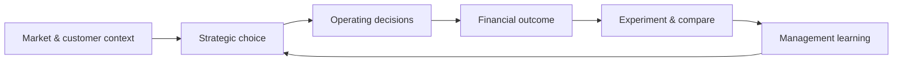

<div align="center">


# ☕ BREW/LAB
### Coffee Shop Strategy — Executive Simulation Analytics

**From operating decisions to profitable growth — an interactive review of 15 simulation runs across three strategic levels.**

[](https://shab-analytics.github.io/coffee-strategy-dashboard/)
&nbsp;


**[→ Launch the interactive simulation analysis](https://shab-analytics.github.io/coffee-strategy-dashboard/)**

</div>

---

## Executive brief

BREW/LAB turns a multi-level coffee-shop business simulation into an executive decision view. Instead of treating each run as an isolated score, the analysis connects **strategy, operating choices, market context and financial outcomes** to show what changed as the simulated business progressed from early-stage operation to more complex growth decisions.

The dashboard is designed for a reader who wants to answer three questions quickly:

| Executive question | What the dashboard reveals |
|---|---|
| **Are we creating economic value?** | Profit outcomes, target achievement and performance dispersion across simulation runs. |
| **Which strategic choices matter?** | Controlled/observational experiments and the strongest positive or negative profit effects recorded in the workbook. |
| **Does the strategy scale?** | Level comparisons, annual trajectories and Level 3 market views without incorrectly reconstructing the workbook's overall L3 result. |

> **Data discipline:** displayed results come from the supplied simulation workbook. Calculated KPIs are labelled as calculated metrics; the dashboard does not invent missing fields or silently substitute assumptions.

---

## The coffee value chain

<div align="center">


*From blossom to cup — the product is the visible end of an interconnected value system.*

</div>

Coffee is a useful strategic system because value is created long before the final transaction. Origin, processing, roasting, preparation and service choices interact to shape **quality, differentiation, cost structure and willingness to pay**. BREW/LAB uses that same end-to-end lens when interpreting the simulation: a strong result is not simply a sales outcome; it is the consequence of aligned strategic and operating decisions.

---

## What is inside the analysis

### 01 — Performance command view
A compact executive view of the simulation portfolio: run performance, targets, averages and level-to-level movement. Filters allow the reader to move from the full portfolio into Levels 1, 2 or 3 without losing the overall context.

### 02 — Run-level economics
Each simulation run can be inspected individually. The dashboard separates workbook-reported values from calculated comparison metrics so that a reader can see both the **reported outcome** and its position relative to the target or peer runs.

### 03 — Profit trajectory
For Levels 1 and 2, annual records are used to show how operating performance developed over time. For Level 3, market-year operating-profit data is presented as a trajectory view only; it is **not** used to recreate the overall L3 game total because the workbook's summary incorporates broader all-market/franchise information.

### 04 — Strategic experiments
The workbook contains **14 controlled/observational strategic tests**. The dashboard makes these searchable and comparable, helping distinguish decisions that improved outcomes from those that weakened them.

### 05 — Strategy playbook
Seven workbook-supported decision rules are distilled into a concise playbook. This section shifts the analysis from *what happened* toward *what an executive should carry forward into the next decision cycle*.

---

## Decision architecture



The project treats simulation as a **closed learning loop** rather than a leaderboard: decide → execute → measure → compare → learn → adapt.

---

## KPI methodology

The following dashboard metrics are calculated from workbook fields and are explicitly identified as derived measures:

| Calculated metric | Formula |
|---|---|
| **Average game total** | Arithmetic mean of `Game total ($)` for the runs currently displayed. |
| **Target achievement** | Number of displayed runs where `Game total ($) ≥ Target ($)` ÷ number of displayed runs. |
| **Average target multiple** | Mean of `Game total ($) ÷ Target ($)` for displayed runs. |

**Level 3 treatment:** the overall game total is taken directly from `Run Summary`. Mature + Emerging operating-profit series from `Data L3` are used for trajectory analysis only and are not presented as a reconstruction of total Level 3 performance.

---

## Data foundation

The published dashboard is a static analytical snapshot generated from the supplied Excel workbook. The analysis uses the workbook sections relevant to simulation performance and strategy:

- `Run Summary` — run-level results and targets
- `Data L1-L2` — annual operating observations for Levels 1 and 2
- `Data L3` — Level 3 market-year observations
- `Experiments & Playbook` — strategic tests and decision rules

No source workbook is exposed through the public dashboard. The GitHub Pages site reads the prepared `data.json` snapshot.

---

## Experience design

The interface deliberately avoids a default spreadsheet/BI-template aesthetic. Its visual system combines an **espresso navigation layer, warm ivory analytical canvas and restrained copper accents** with compact typography and progressive disclosure. Coffee imagery establishes the brand context; the analytical surface remains intentionally calm so the data—not decoration—carries the argument.

The site is responsive and designed for desktop and mobile viewing. It uses no external chart library or runtime API, reducing deployment dependencies and keeping GitHub Pages hosting straightforward.

---

## Launch the analysis

<div align="center">

### Ready to explore the simulation?

[](https://shab-analytics.github.io/coffee-strategy-dashboard/)

**[shab-analytics.github.io/coffee-strategy-dashboard](https://shab-analytics.github.io/coffee-strategy-dashboard/)**

</div>

---

<details>
<summary><strong>Technical structure & deployment</strong></summary>

### Project files

```text
coffee-strategy-dashboard/
├── index.html
├── styles.css
├── app.js
├── data.json
├── README.md
├── .nojekyll
└── assets/
    ├── coffee-dashboard-hero.png
    ├── coffee-bean-to-cup.png
    └── coffee-lifecycle.svg
```

### GitHub Pages deployment

1. Upload all project files and the `assets` directory to the repository root.
2. Open **Settings → Pages**.
3. Choose **Deploy from a branch**.
4. Select `main` and `/(root)`.
5. Save and wait for GitHub Pages to publish the site.

### Updating the Excel data

When the simulation workbook changes, regenerate the dashboard's `data.json` snapshot from the relevant workbook sheets rather than manually editing values in the interface. Preserve field names and validate missing/unexpected values before deployment.

</details>

---

<div align="center">

**BREW/LAB · Strategy brewed from evidence.** ☕

*Interactive simulation analysis · Executive decision storytelling · GitHub Pages*

</div>
