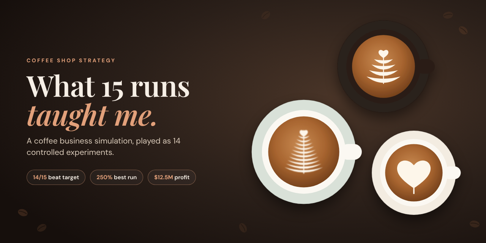
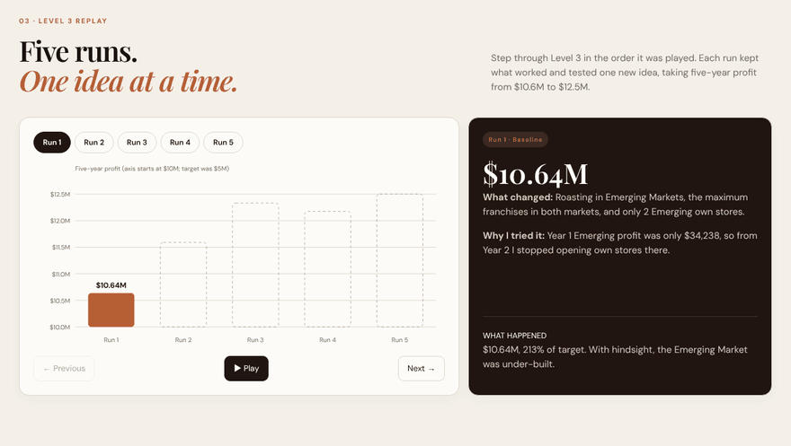
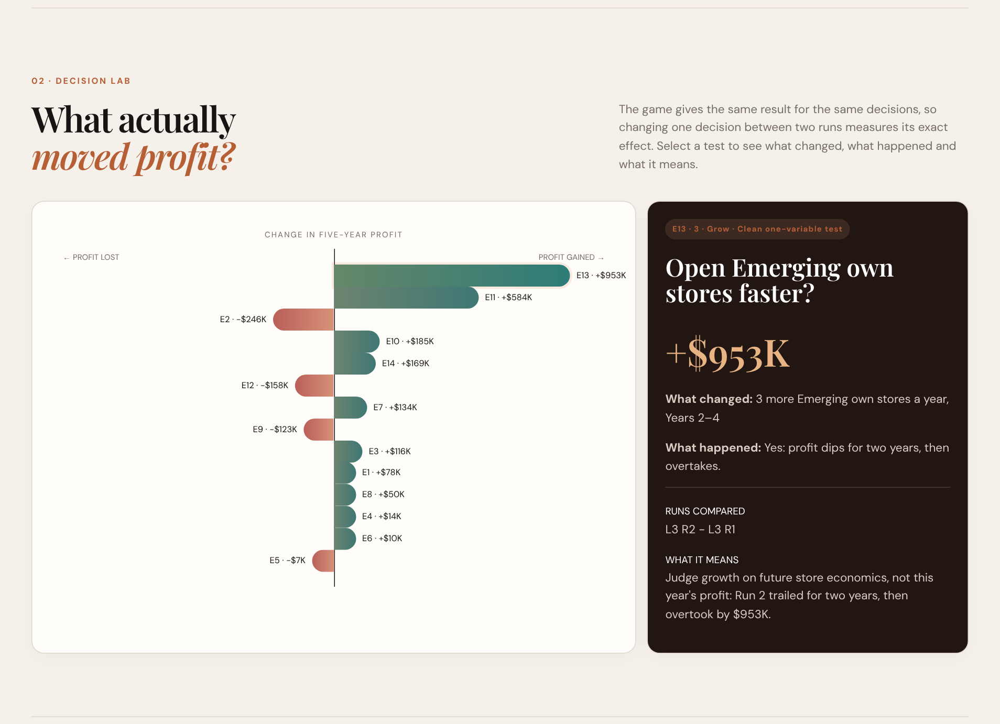
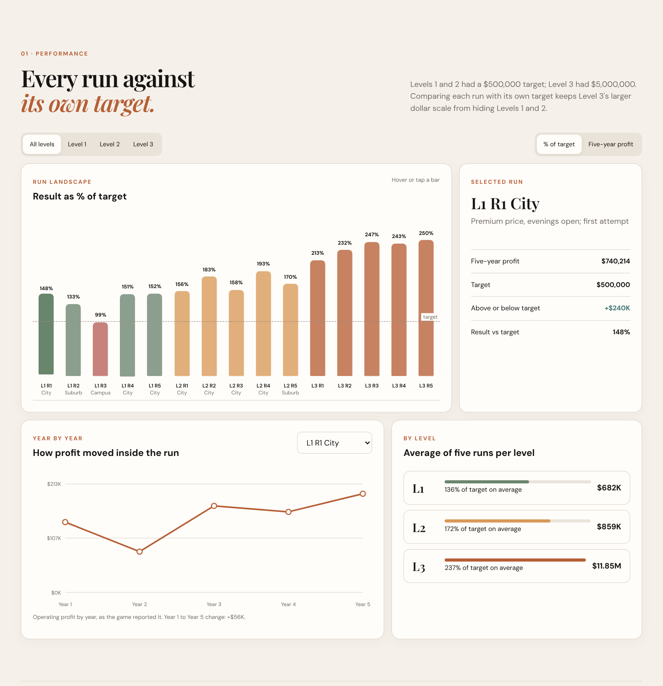
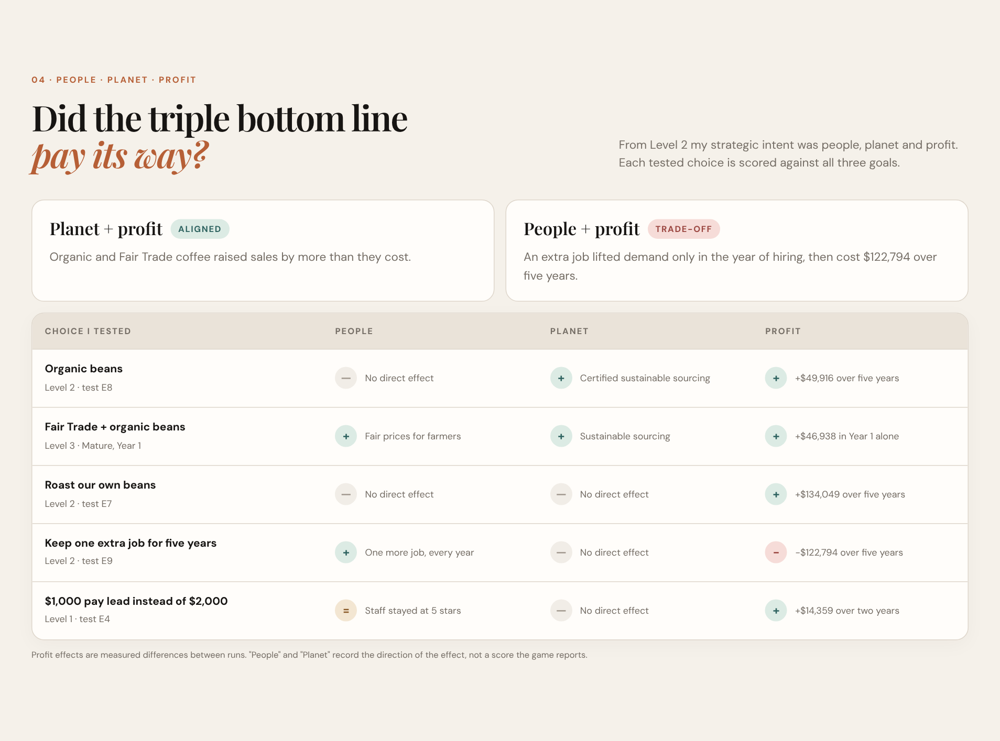
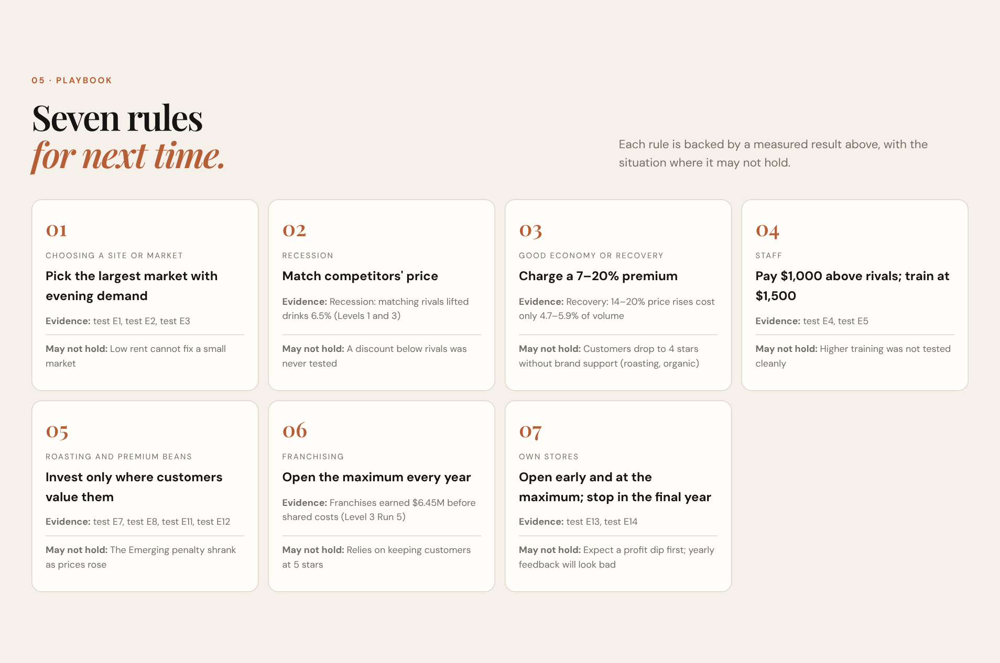
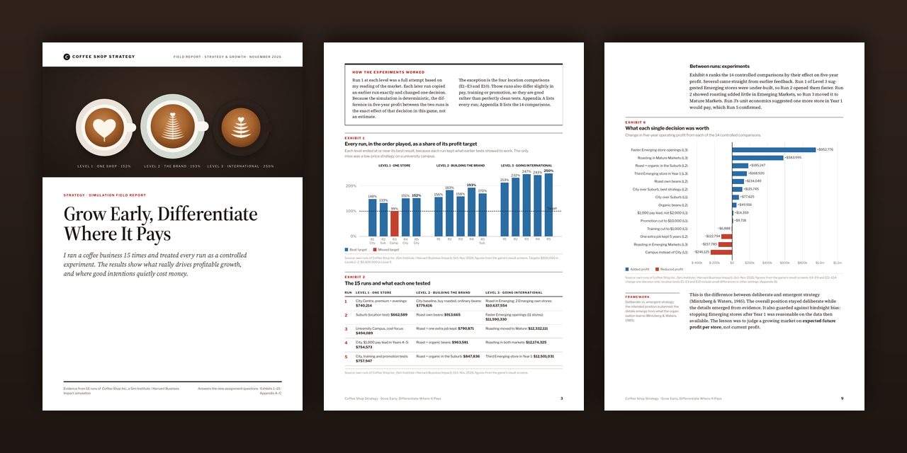

  

  
  
  

<h3 align="center">I ran a coffee business 15 times. Then I treated every run as an experiment.</h3>

One shop, then a brand, then an international chain. Same news, same customers, one decision changed at a time. Here is what actually moved profit, measured to the dollar.

---

## ☕ The answer in three sips

| | Principle | The evidence |
|:-:|---|---|
| **1** | **Choose the market before the tactics** | The City Centre out-earned the University Campus by **$246,125**. Low rent could not rescue a small, price-sensitive market. |
| **2** | **Differentiate only where customers pay for it** | Roasting our own beans added **+$583,995** in Mature Markets and cost **−$157,785** in Emerging ones. Same roaster, opposite answers. |
| **3** | **In a growing market, speed is the moat** | Opening Emerging stores faster added **+$952,776**, after trailing for two years first. |

  <b>152%</b> of target in Level 1 &nbsp;·&nbsp; <b>193%</b> in Level 2 &nbsp;·&nbsp; <b>250%</b> in Level 3 ($12.5M)

---

## 🎞️ Watch Level 3 grow, one idea at a time

Each run kept what worked and tested one new idea: faster openings, roasting moved to where customers valued it, one extra early store. Five-year profit climbed from **$10.64M to $12.50M**.

---

## 🔬 The Decision Lab: what each choice was worth

The simulation is deterministic: the same decisions always give the same result. So changing **one** decision between two runs measures its exact value. Fourteen tests, from **+$952,776** (open stores faster) to **−$246,125** (pick the campus).

<b>More from the dashboard</b> (performance, scorecard, playbook)

 

  

  

---

## 📄 The field report

**Grow Early, Differentiate Where It Pays**: a 23-page business-journal style write-up with 15 exhibits, Porter's Five Forces, a VRIO test, break-even maths and an honest section on where my judgement was wrong. [Read it here →](https://shab-analytics.github.io/coffee-strategy-dashboard/report.html)

---

## 🧭 What's on the site

| Section | What you'll find |
|---|---|
| **Performance** | All 15 runs against their targets, year-by-year profit, averages by level |
| **Decision Lab** | 14 controlled tests ranked by profit impact: what changed, what happened, what it means |
| **Level 3 Replay** | Runs 1–5 step by step, from $10.6M to $12.5M |
| **People · Planet · Profit** | Every tested choice scored against a triple-bottom-line intent |
| **Playbook** | Seven decision rules, with the evidence and when they might not hold |

## 🧪 Method, briefly

- Every figure comes from the game's own result screens. Nothing is estimated.
- Each later run copied an earlier one exactly and changed one decision, so the profit difference is that decision's exact effect in the game.
- The location tests (E1–E3, E10) also differ slightly in pay, training or promotion, so treat them as good rather than perfectly clean comparisons.
- The game is a simplification: real customers, rivals and capital limits are messier. Read the findings as decision principles, not forecasts.

## 🗂️ Files

| File | Purpose |
|---|---|
| `index.html`, `styles.css`, `app.js` | The site (plain HTML, CSS and JavaScript, no build step) |
| `data.json` | Every figure on the page |
| `report.html` → `Coffee_Shop_Simulation_Report.pdf` | The field report |
| `` | README images and animations |

---

  Built from my own runs of <i>Coffee Shop Inc.</i> (Sim Institute / Harvard Business Impact), October–November 2026. 
  Made with ☕ by <b>Shabnam Mohammed Sameer</b> · If this helped you think about strategy, a ⭐ is always appreciated.

